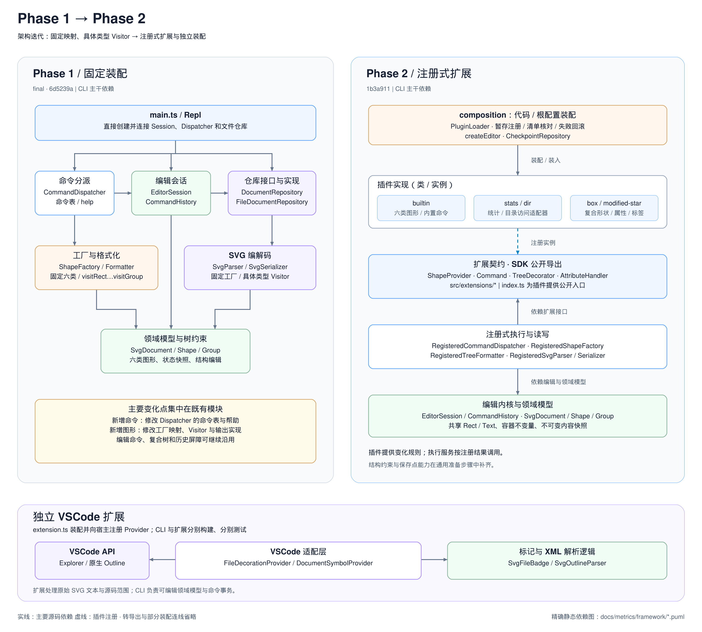

# Phase 1 → Phase 2 迭代报告

Phase 2 将 CLI 的命令、图形、属性语义和树标签接入注册机制。新增的 stats、dir、box 和 modified-star 通过公开接口工作；原有编辑命令、文档树和撤销机制继续承担事务。VSCode 扩展则独立提供 SVG 文件标记与原生大纲。

## 1. 对比基准与架构图

| 阶段 | 基准 | 比较范围 |
|---|---|---|
| Phase 1 交付 | `final`，`6d5239a` | 固定六类图形的 CLI，含结构编辑、SVG 读写和历史屏障 |
| Phase 2 功能完成 | `1b3a911` | 注册框架、命令插件、box、两个标签及 VSCode 扩展 |

本报告及图的功能基准固定到上述提交。CLI 数字来自 [metrics 快照](../../docs/metrics/framework/summary.json)，其源码摘要通过 metrics:check 校验；从 final 到当前端也包含先行的 Phase 1 职责拆分准备。VSCode 扩展按独立项目核验，不计入 CLI 指标。



[SVG 源图](diagram/phase1-phase2-architecture.svg)可继续编辑；[2 倍 PNG](diagram/phase1-phase2-architecture@2x.png)用于文档展示。图中实线表示主要源码依赖，虚线表示注册方向，省略了兼容转导出和部分装配连线。精确到模块目录的静态依赖见自动生成的 [Phase 1 PlantUML](../../docs/metrics/framework/before.puml) 与 [Phase 2 PlantUML](../../docs/metrics/framework/after.puml)。

## 2. 哪些职责发生了变化

### 2.1 固定映射转为注册表

Phase 1 的 main.ts 直接创建 FileDocumentRepository、EditorSession、CommandDispatcher 和 Repl。CommandDispatcher 内的 Map 同时保存命令名和处理函数，负责参数、帮助和执行反馈；ShapeFactory 内的 Map 固定列出 rect、circle、ellipse、line、text、g。ShapeVisitor 则声明六个 visit 方法，新增类型需要协调工厂与各个输出实现。

Phase 2 的 [startCli](../../src/composition/startCli.ts)先建立默认框架，再选择代码或配置装入可选插件。[createEditor](../../src/composition/createEditor.ts)把同一组注册结果接入命令分派、工厂、SVG 读写和检查点通知。内置命令与六类 Provider 移入 plugins/builtin，RegisteredCommandDispatcher 根据注册的 Command 执行，RegisteredShapeFactory 根据 ShapeProvider 的 schema、构造器和 SVG 映射工作。

| 变化点 | Phase 1 | Phase 2 | 实际效果 |
|---|---|---|---|
| 命令 | Dispatcher 内固定命令表 | Command 注册表，帮助来自实例 | stats、dir 独立接入，禁用后回到未知命令 |
| 图形 | ShapeFactory 固定六类映射 | ShapeProvider + RegisteredShapeFactory | box 的创建、展示、读回集中在插件 |
| 输出 | 六方法 Visitor 了解具体类型 | 通用 visitShape，类型策略由 Provider 提供 | 新类型不扩张访问器方法列表 |
| 属性 | 图形自身的可改属性规则 | AttributeRouter 先匹配处理器，再回退原规则 | box 的 fill/label 语义独立注册 |
| 树标签 | TreeFormatter 生成固定文本 | TreeDecorator 顺序组合行尾标签 | `(box)` 与 `*` 可分别禁用、调整顺序 |
| 装配 | main.ts 直接连接具体实现 | composition 选择插件并校验清单 | CLI 执行服务通过注入工作 |

原有 [EditorSession](../../src/application/session/EditorSession.ts)、CommandHistory 和编辑命令保留了撤销重做职责。结构变更由 SvgDocument 维护 ID、父子关系和对象归属；状态快照保证失败回滚。这些基础承担新增插件的编辑行为，插件无需另建一套历史栈。

### 2.2 四个扩展点与依赖方向

[公开 SDK](../../src/extensions/index.ts)导出插件需要的领域模型和接口。插件访问宿主时使用该入口；内核执行服务依赖接口，装配层负责选择具体实现。静态边界检查会拒绝插件导入宿主装配模块或私有内核文件。

| 扩展点 | 主要调用位置 | 本阶段实现 | 缺省行为 |
|---|---|---|---|
| ShapeProvider | RegisteredShapeFactory、ShapeViews、SVG 解析与序列化 | 六类内置 Provider、BoxProvider | 默认框架保留六类；未装 box 时创建报未知类型，读取带标记的 g 警告降级 |
| Command | RegisteredCommandDispatcher.dispatch | 内置 BoundCommand、StatsCommand、DirCommand | 未注册命令报错，help 只显示已注册命令 |
| AttributeHandler | SetCommand → AttributeRouter.apply | BoxAttributes | 未命中回退原属性规则；多个命中在修改前报冲突 |
| TreeDecorator | RegisteredTreeFormatter.labels；CheckpointRepository.publish | BoxTypeDecorator、ModifiedStarDecorator | 无标签时保留原树文本；检查点回调可省略 |

完整的注册、调用与违约处理清单见 [FRAMEWORK.md](FRAMEWORK.md)。职责拆分落实了 SRP；服务依赖扩展接口、装配处依赖具体实现，对应 DIP。OCP 的验证落在真实插件上：stats、dir 和 box 的业务规则进入各自包，原有执行服务按注册结果调用。四个接口分别面向一种变化，标签的可选 checkpoint 也让无状态实现无需提供空回调。

## 3. 插件如何使用原有能力

### 3.1 stats 与 dir

stats 从画布子节点按深度优先顺序统计叶子类型，容器单独计数。它查询公开的 children 和容器能力，不列举 box 等具体名称，也不修改历史。

[DirectoryAccess](../../src/plugins/dir/DirectoryAccess.ts)是目录访问的目标接口，DirCommand 使用它取得工作目录和子项；[NodeDirectoryAccess](../../src/plugins/dir/NodeDirectoryAccess.ts)把 Node 的文件系统调用适配成该接口。命令测试用替身覆盖排序、隐藏项和错误，真实适配器再用临时目录验证。这个边界让文件系统读取与 CLI 文案、排序规则分开变化。角色和错误格式见 [COMMAND_PLUGINS.md](COMMAND_PLUGINS.md)。

### 3.2 box 复合图形

box 继承 Group，复用公开 Rect/Text 模型，内部 ID 派生为 `<id>-rect` 和 `<id>-label`。创建前对整棵新增子树查重；必需组件缺失或被移走时拒绝结构修改。移动、缩放、删除和撤销仍走原编辑命令。

BoxAttributes 把 fill 转给内部矩形、把 label 转给内部 Text，一次 set 仍是一个 undo 单元。处理器部分修改后抛错时，原子树快照恢复所有组件并保留 redo。序列化写出 `<g data-kind="box">`；已安装插件时严格拒绝缺少必需部件的读入，未安装时按普通 g 警告降级。契约见 [ADR 005](adr/005-composite-containers.md)。

### 3.3 标签与内容检查点

两个标签互不导入。BoxTypeDecorator 提供 `(box)`，ModifiedStarDecorator 用实例 WeakMap 保存各文档的成功读写检查点。默认顺序生成 `g#n (box) *`，反向注册则生成 `g#n * (box)`。

星号按当前内容与保存点比较，包含几何、样式、Provider 文本、父级和有序子树。新建节点立即标星；修改向祖先传播；undo 回到保存内容后星号消失。树快照按需生成，同次查询共享。CheckpointRepository 在成功读写后通知，故障回调逐个隔离并报告，健康标签仍收到通知，已完成 I/O 的路径和屏障记账继续生效。状态机与故障处理见 [TREE_LABELS.md](TREE_LABELS.md) 和 [ADR 006](adr/006-content-checkpoints.md)。

## 4. VSCode 扩展的独立边界

扩展的 [extension.ts](../../vscode-extension/src/extension.ts)装配规则与适配器，向宿主注册 FileDecorationProvider 和 DocumentSymbolProvider。前者只给普通 SVG 文件加 `[]`；后者把原始 XML 的层级与 UTF-16 源码范围映射到原生 Outline，支持定位及未保存编辑后的更新。

CLI 需要可编辑模型、严格导入规则与命令事务；扩展需要接受任意 SVG 标签、保留源码位置，并在文本暂时不完整时返回空大纲。两者因此分别构建和测试。扩展采用 XML 解析器和 VSCode 文件系统适配器，复用的是接口分离与依赖注入的组织方式。截图、复用评估及宿主验证见 [扩展 README](../../vscode-extension/README.md) 和 [verification.md](../../vscode-extension/docs/verification.md)。

## 5. 两种装配与实际提交边界

代码方式在 [codePlugins.ts](../../src/composition/codePlugins.ts)提供类型明确的加载入口；配置方式从根 [plugins.config.json](../../plugins.config.json)读取模块列表。两者都进入 PluginLoader 的暂存注册、contributes 集合比对、冲突检查和同步发布。失败只撤销本次暂存贡献，随后继续启动；未启用的配置项不解析、不加载。细节见 [ADR 004](adr/004-plugin-loading.md)。

| 节点 | 提交 | 结果 |
|---|---|---|
| Phase 1 职责拆分 | `947a6e9` | 为后续注册机制分离命令处理与输入转换 |
| VSCode 实践 | `97f02cb` | 文件标记和原生大纲 |
| 框架可扩展 | `77f0035` | 四个扩展点、默认装配和边界检查 |
| 命令插件 | `27950b0` | stats、dir 及同一加载路径 |
| box | 准备 `1af7bae`；配置 `9559e0c`；代码 `8f3aeb0` | 复合容器约束、独立配置与代码接入 |
| 标签 | 准备 `84c281c`；根配置 `f47e813`；代码 `1b3a911` | 保存点通知、标签状态机和双装配 |

根配置接入与代码装配有各自可运行的提交。以下命令分别验证标签配置提交未改既有运行源码，以及随后代码装配只修改一个运行文件：

```powershell
git diff f47e813^ f47e813 -- src ':(exclude)src/plugins/modified-star'
git diff --name-only 1b3a911^ 1b3a911 -- src
```

第一条为空，第二条只列 src/composition/codePlugins.ts。box 的配置接入同样可用 `git diff 9559e0c^ 9559e0c -- src ':(exclude)src/plugins/box'` 复核。每个阶段都重新采集对应源码指标并运行完整测试；标签三个阶段分别通过 328、344、345 项 CLI 测试。[阶段组合记录](labels-stage-validation.json)用于复跑源码与测试分组，实际提交边界以上述 Git 差异为准。

## 6. 指标与验证结果

### 6.1 CLI 指标

| 指标 | Phase 1 / final | Phase 2 / 1b3a911 | 增量 |
|---|---:|---:|---:|
| TypeScript 源文件 | 48 | 126 | +78 |
| 内核文件 | 47 | 59 | +12 |
| 装配文件 | 1 | 39 | +38 |
| 插件文件 | 0 | 28 | +28 |
| 内核行数 | 2549 | 2514 | −35 |
| 装配行数 | 9 | 574 | +565 |
| 插件行数 | 0 | 1062 | +1062 |
| 总行数 | 2558 | 4150 | +1592 |
| 函数数 | 334 | 497 | +163 |
| AST 总复杂度 | 643 | 1003 | +360 |
| 单函数最大复杂度 | 26 | 21 | −5 |
| 内部依赖边 | 179 | 320 | +141 |

新增注册协议、插件、兼容入口和检查点能力增加了文件数与总复杂度。单函数最大复杂度下降，职责分布到更多模块；内核行数只减少 35 行。变化收益主要体现在新增规则的落点与依赖边界，新增协议也带来装配、契约和错误处理成本。

统计覆盖 CLI 的 src/**/*.ts；旧入口的纯转导出归为装配，VSCode、测试、脚本和依赖不在口径中。行数、复杂度及依赖均由 [collect-metrics.mjs](../../scripts/collect-metrics.mjs)采集。inventory 中 headRevision 记录采集时基于的提交，逐源码摘要与当前功能提交的一致性由 metrics:check 验证。

### 6.2 测试与可重放会话

| 证据 | 结果与范围 |
|---|---|
| CLI 全量 | 345 项单元及集成测试；保留 Phase 1 原始预期，基线回归显式禁用可选标签 |
| box 专项 | 17 项，覆盖独立插件、读写、约束、配置与代码装配 |
| 标签专项 | 17 项，覆盖状态机、隔离、回调故障及双装配 |
| VSCode 单元 | 10 项，单独构建和类型检查 |
| VSCode 宿主 | 已保存的 8 项通过记录，环境为 VSCode 1.145.2 / Node v24.22.1；本次报告复核引用该记录 |
| 提交后长会话 | 每种装配 66 条，共 132 条；stdout 和最终 SVG 逐字节相同，几何及文本检查通过 |

标签与 box 专项属于 CLI 全量测试的一部分。VSCode 宿主记录见 [host-tests.json](../../vscode-extension/docs/host-tests.json)。

长会话的 [命令输入](verification/integration-commands.txt)、[预期 stdout](verification/integration-expected.stdout.json)、[预期 SVG](verification/integration-expected.svg)和[结果记录](verification/integration-result.json)已保存。它覆盖所有内置 CLI 命令，以及 stats、dir、box 和两个标签；每次会话包含 7 个刻意的错误输入，包括删除必需组件、拆开 box、未知属性、错误参数和 I/O 后撤销，后续命令均继续执行。

复跑命令：

```powershell
npm run build
python doc/Phase2/verification/replay-integration.py
npm test
npm run typecheck
npm run check:boundaries
npm run metrics:check
npm --prefix vscode-extension test
npm --prefix vscode-extension run typecheck
```

回放脚本在临时工作目录内建立 assets，日志留在内存中；第二种装配运行前删除第一种的输出文件，两侧从相同目录内容开始。两次结果与记录逐字节比较，再检查保存文件中的画布尺寸、10 个元素、矩形几何、标题、正文和层级。

## 7. 本轮取舍

结构约束与内容检查点是在 box、标签实践时补进框架的。它们修改过内核契约和渲染器，反映了框架节点原先缺少的能力。分步提交能验证准备之后的插件接入边界；若严格按“首次新增标签时内核与渲染器零改动”验收，本次准备步骤仍构成差异。这一限制保留在 [标签审查处理](LABEL_REVIEW_RESOLUTION.md)中。

当前快照为每个节点保存规范化子树字符串，深链结构有 O(n²) 的时间和空间开销。懒计算与无监听者时跳过投影已减少常见路径的额外工作，后续可将自身内容指纹与子树聚合分开。

插件目前使用本仓库布局下的 main 路径，随宿主一起构建。独立发布需要继续整理 SDK 包和构建产物布局；VSCode 扩展仍保留自己的解析目标与测试边界。
