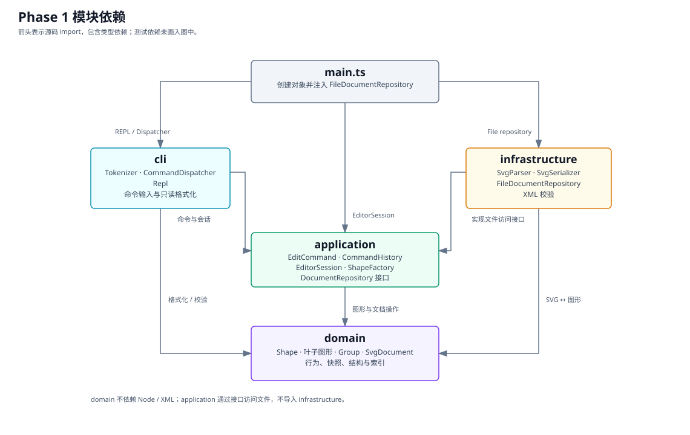
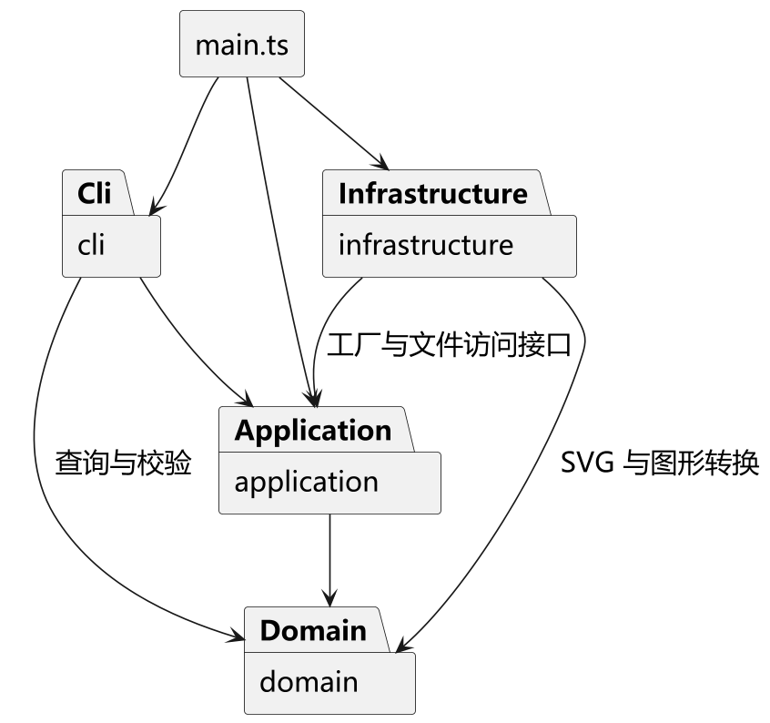

# SVG 编辑器 Phase 1 设计与验证

本项目按[实验要求](Phase1/phase_cli_1.md)实现 TypeScript 命令行 SVG 编辑器，支持 rect、circle、ellipse、line、text 和 g，以及编辑、分组、撤销重做和 SVG 读写。

## 架构方案

### 模块划分

| 模块 | 职责 | 主要实现 |
| --- | --- | --- |
| src/domain | 图形几何与样式、组合结构、状态恢复、文档索引和校验 | Shape、五种叶子图形、Group、SvgDocument、ShapeState |
| src/application | 编辑命令、历史、文档生命周期、图形创建；定义文件访问接口 | EditCommand、CommandHistory、EditorSession、ShapeFactory、DocumentRepository |
| src/cli | 分词、按命令名分发、REPL、反馈与查询格式化 | Tokenizer、CommandDispatcher、Repl、各 Formatter |
| src/infrastructure | XML/SVG 与领域对象转换、磁盘读写 | SvgParser、SvgSerializer、FileDocumentRepository、XmlText、XmlReferences |
| src/main.ts | 创建对象并注入具体文件仓库，启动 REPL | 装配入口 |
| tests | 单元测试与集成测试 | 按层组织测试，tests/integration 回放真实 CLI |
| examples | 会话脚本、导入样例和生成的 SVG | 实验会话、拒绝输入和视觉对照样例 |

源码按一类一文件组织，类名与文件名对应。图形字段由类管理，几何、样式和子节点通过只读副本查询。

下图展示了各模块之间的依赖关系：

### 设计模式及落地

#### Command：把编辑操作封装成可撤销的命令

编辑命令继承 EditCommand，通过 execute 和 undo 操作文档。CommandHistory 保存这些命令对象，统一管理执行、撤销和重做；具体如何修改图形、恢复状态，由各命令负责。

- **执行移动：`move r1 10 20`。** CommandDispatcher 解析参数后创建 MoveCommand，再交给 EditorSession 和 CommandHistory 执行。MoveCommand 通过 ShapeEditCommand 保存操作前的 ShapeState，调用目标图形的 move 方法，成功后保存操作后的状态并进入撤销栈。scale 和 set 使用同一套状态保存与恢复流程。
- **撤销：`undo`。** CommandHistory 取出撤销栈顶的命令，调用它的 undo 方法。例如，撤销移动会恢复移动前的坐标；撤销 set 会恢复原属性，包括“原来没有设置这个属性”的情况。撤销成功后，该命令才从撤销栈移到重做栈。撤销直接恢复快照中保存的原值。
- **重做：`redo`。** CommandHistory 取出重做栈顶的同一个命令对象，再调用 execute。对于 move、scale 和 set，ShapeEditCommand 会恢复首次执行后保存的状态，重做使用命令中已保存的执行结果。重做成功后，命令移回撤销栈；撤销之后执行新的编辑命令，则清空重做栈。
- **删除及其撤销：`delete flow`。** DeleteCommand 保存目标对象、父容器、原位置和图形状态，再由 SvgDocument 删除目标及其整棵子树。撤销时，将原对象放回原父容器的原位置，并恢复状态。group、ungroup、addto、front 和 back 涉及树结构变化，由 StructureCommand 保存 StructureEdit，记录受影响列表的前后状态，以便恢复父级与顺序。

执行、撤销或重做失败时，历史栈保持不变。init、read、save 和修改尺寸的 canvas 由 EditorSession 处理，不进入编辑历史；成功后清空历史并建立屏障，直到下一次成功编辑才开始新的历史。

#### Composite：用统一接口操作叶子图形和组合图形

Rect、Circle 等叶子图形与 Group 都继承 Shape。Group 的子节点也是 Shape，因此一个组既可以包含普通图形，也可以包含另一个组。调用方通过同一套接口操作它们，具体行为由对象自身实现。

- **移动组合图形：`move flow 10 20`。** MoveCommand 查找 flow 后直接调用它的 move 方法。若目标是 Rect，就修改矩形坐标；若目标是 Group，Group 就逐个调用子节点的 move，子组继续向下递归。具体行为由目标对象的方法决定，嵌套组中的每个叶子图形都会移动一次。
- **缩放组合图形：`scale flow 2`。** ScaleCommand 同样只调用 Shape 的 scale。Group 将缩放操作传给子节点，各叶子类按自身几何含义修改坐标和尺寸。整个组是一次编辑，撤销时通过组的递归状态快照一起恢复。
- **设置组合样式：`set flow fill blue`。** Group 沿用 Shape 的公共样式接口，将 fill 设置在组自身。子图形没有显式 fill 时，渲染时继承组的颜色；已有显式颜色的子图形保留自己的设置。ungroup 移除组后，子图形按新的父级关系继承样式。

#### 简单工厂与集中分派：统一命令入口和图形创建入口

CommandDispatcher 用一个 Map 将命令名映射到处理方法；ShapeFactory 用另一个 Map 将图形类型名映射到 ShapeDefinition。命令查找与对象创建集中在这两个入口，其余代码通过对象接口完成操作。

- **创建图形：`create rect r1 30 70 120 60`。** CommandDispatcher 先找到 create 的处理方法，再把类型 rect、id 和参数交给 ShapeFactory。工厂通过对应的 ShapeDefinition 解析参数并构造 Rect，随后由 CreateCommand 将对象加入文档。参数转换集中在创建入口，几何约束仍由图形类校验。
- **从文件创建图形：`read demo.svg`。** SvgParser 读取 XML 元素和属性后，调用同一个 ShapeFactory 的 createFromAttributes 创建图形。CLI 输入与 SVG 导入共用类型定义、几何属性顺序和缺省规则。整份文件解析成功后，EditorSession 才替换当前文档。

当前实现采用简单工厂。按实验要求，这两处 Map 查找保留为集中分派的待重构点；以后增加图形类型时，除了实现图形类，还需要补充工厂定义和访问者方法。

#### Visitor：将输出格式与图形行为分开

ShapeVisitor 为每种图形声明访问方法，图形的 accept 方法调用与自身类型对应的方法。终端输出和 SVG 输出各自实现访问者，图形类提供数据与行为，输出格式由访问者负责。

- **查看图形：`show r1`。** ShapeFormatter 将自身作为访问者传给目标图形。Rect.accept 调用 visitRect，Circle.accept 调用 visitCircle，各访问方法读取对应的几何信息并生成文本。增加一种输出格式时，可以新增一个访问者。
- **查看文档树：`tree`。** TreeFormatter 通过统一的 children 接口递归遍历节点，再调用 ShapeFormatter 生成每个节点的摘要。遍历负责树的层次和顺序，访问者负责不同图形的显示内容。
- **保存 SVG：`save demo.svg`。** SvgSerializer 实现 ShapeVisitor，从文档根节点按当前顺序调用 accept。普通图形生成对应的 XML 元素；visitGroup 生成 g 元素，并继续访问子节点。序列化完成后，FileDocumentRepository 写入文件。终端显示与 SVG 序列化分别通过访问者处理各自的格式细节。

### 依赖方向规则

| 模块 | 可以依赖 | 原因 |
| --- | --- | --- |
| domain | 本层模块 | 图形行为独立于终端、文件和 XML，便于直接测试 |
| application | 本层、domain | 编排编辑与恢复，通过自己定义的 DocumentRepository 接口访问文件 |
| cli | 本层、application、domain 的查询与校验接口 | 处理输入与反馈，文件读写交给 application 的接口 |
| infrastructure | 本层、application、domain，以及 Node 文件接口和 XML 库 | 实现文件接口，完成格式转换 |
| main | 各层 | 负责创建对象、注入依赖并启动程序 |

### 变化点假设

| 可能变化 | 已保留的接口或分工 | 本阶段的实现选择 |
| --- | --- | --- |
| 增加 GUI 或 agent 入口 | 编辑命令和 EditorSession 可供多个入口复用 | 当前只要求 CLI，先验证同一套编辑与历史行为 |
| 增加图形或 box 插件 | Shape 多态、集中工厂和命令入口 | 后续插件注册需要扩展 Map 分派及 Visitor 接口 |
| 扩大 SVG 支持范围 | XML 转换集中在 infrastructure，支持与拒绝输入都有测试 | 本阶段按实验白名单读写 SVG，对 transform 和额外字体属性报错 |
| 改用其他存储方式 | DocumentRepository 接口，EditorSession 只处理成功或失败结果 | 当前采用同步的本地文件读写 |
| 调整撤销策略 | 历史管理独立，属性状态和结构状态分别恢复 | 当前历史保存在内存中，属性编辑保存状态快照，结构编辑恢复列表并重建索引 |

## 过程记录

本项目由我与 Codex 协作完成。Codex 主要承担代码、测试和文档初稿的编写，我负责提出要求、审核阶段结果和决定修改范围。遇到自己暂时看不懂的 TypeScript 实现时，我会请另一个 agent 独立审查，再把报告交给 Codex 核对。下面记录几次对最终实现影响较大的讨论。

### 先确定开发方式，再开始写代码

开始时，我考虑过参考类似的开源项目，讨论后决定围绕实验要求的类层次、多态和设计模式从零实现，并让 Codex 先给出多阶段方案。我又明确要求采用测试驱动开发来完成本次 PJ，每个阶段完成后先留给我审核，不要立即提交。

### 明确 front/back 的顺序语义

阅读实验说明时，我对 front/back 的“前”和“后”产生了疑问：是把节点放到列表前面，还是让图形显示在其他图形上面？我连续追问了 front 的移动方向和 z-order 的含义，也指出这类表述容易产生歧义。

讨论后明确，SVG 按节点顺序绘制，后绘制的图形覆盖先绘制的图形。因此 front 应把目标移到同一父容器子列表的末尾，back 则移到开头。实现和测试都按这个规则处理。最终验收还用重叠图形检查了视觉结果：执行 front 后目标显示在上层，执行 back 后重新被遮挡。

类似地，我在开始开发前询问了椭圆的 rx、ry、ungroup 的含义，以及“公共数据袋加自由函数”的写法为什么不符合要求。这些讨论帮助我理解方案里的 Shape、Group 和命令对象分别承担什么职责。

### 独立审查通过后，仍然处理封装风险

图形模型阶段完成后，因为我还不熟悉 TypeScript，我让 Codex 写了一份审查 prompt，请另一个 agent 检查实现。报告指出 TreeAccess 导出的符号能被外层导入，从而绕过 SvgDocument 替换 Group 的子列表，使文档树与 id、父级索引脱节。

我把报告交回 Codex，先询问哪些意见值得采纳，再决定处理这项风险和测试缺口。修正采用了独占的结构访问句柄：附着在文档上的 Group 由文档持有句柄，外部不能再次取得；节点移除后才释放。测试同时补查重排后移动节点和其他兄弟的 indexOf，并将只读性检查改为验证外部取得的列表不能影响内部树。

后续分组、删除和撤销都依赖文档索引。我要求在进入下一阶段前收紧结构修改入口，补齐回归测试，审核后提交。

### 取舍审查意见，修正 SVG 读入边界

后续阶段仍采用“实现、独立审查、核对意见、修正”的顺序。我先请 Codex 区分实际问题与后续优化，再决定修改范围。例如，阶段 5 我选择修复空字符串样式在终端中的显示，测试运行日志则不作为提交内容，并要求删除后再提交。

SVG 读写阶段的审查指出了两个具体边界：XML 库对某些裸 & 不报警；使用 image/svg+xml 模式时，还可能替未声明命名空间的输入补上默认 SVG 命名空间。这与项目要求的严格读入不一致。我同意采纳相应修正并补上边界测试，由 Codex 先写测试确认问题，再增加 XmlReferences 检查引用语法、改用 application/xml 解析并核对真实的命名空间。

测试除了检查非法文件被拒绝，还检查读入失败后原文档和 redo 保持不变。文件先完整解析成新文档，成功后再替换当前会话；失败时保留正在编辑的内容。这里的问题由审查 agent 发现，代码和回归测试由 Codex 完成，我负责确认修改范围和审核后提交。

## 一致性自查

### 模块划分核对

四个业务目录和 main 与原方案一致。校验类、状态快照、结构访问句柄及 XML 引用检查分别留在所属职责层；tests/integration 承担完整会话验收。

src 共 48 个 TypeScript 文件：43 个类文件、3 个接口文件、1 个结构访问符号文件和 main 入口。类名与文件名对应，每个类文件只有一个导出类。图形行为由类实现，字段按 TypeScript 的 private/protected 封装；几何、样式和子列表通过冻结副本查询。

### 依赖方向核对

扫描全部 import 后，实际依赖符合规则：domain 只引用本层；application 只引用本层和 domain；cli 与 infrastructure 分别按方案引用 application/domain。main 实际只导入 cli、application 和 infrastructure。初稿画出的 main→domain 直连已按实际代码删除。

命令名和图形类型名查找集中在 CommandDispatcher、ShapeFactory 两处；格式化和 SVG 输出通过 Visitor。

## 质量保证手段

### 单元测试

单元测试使用 Node 自带的 node:test 和 assert，按 domain、application、cli、infrastructure 分目录组织，通过公开接口检查对象状态和操作结果。

- **图形与组合行为**：检查各类图形的移动、缩放、属性设置和参数校验，以及嵌套 Group 的递归操作。溢出测试将会失败的节点放在组内后部，检查前面已经修改的节点是否一起恢复。
- **结构与历史**：检查 id 唯一性、父级和索引，核对分组、解组、跨容器移动及前后重排的结果；执行撤销和重做后，再次检查几何、样式、父级及顺序。历史测试覆盖失败时保留栈、新编辑清空 redo，以及文档操作建立历史屏障。
- **输入与文件处理**：检查引号、反斜杠、中文、空字符串样式和错误反馈；SVG 测试覆盖缺失 id 的补全、命名空间、实体引用、特殊字符和重复读写。文件测试检查读写失败后的文档、默认路径及目标文件内容。

开发各功能时先编写测试，再实现相应行为；审查发现的问题补充为回归用例。通过 npm test 构建并运行全部测试，当前单元测试与集成测试合计 224 项，全部通过。

### 集成测试

集成测试通过 SessionReplay 启动编译后的 main，将会话脚本送入真实 CLI 的标准输入，在独立临时目录中执行文件读写。测试逐条比较终端反馈，并读取保存的 SVG，核对图形属性、树结构、父级和节点顺序。

- [实验第 6 节会话](../examples/phase8-session.cli)：覆盖创建、分组、移动、撤销重做、文字修改、删除恢复、保存和读入，比较完整反馈及两次文档树输出。
- [第 6.1 节中文流程图](../examples/phase8-flowchart.cli)：检查组合节点移动后的撤销结果、中文文字修改和保存后的几何信息。
- [混合边界会话](../examples/phase8-edges.cli)：连续执行编辑、结构调整和非法导入，检查错误反馈以及后续编辑、保存的结果。
- [视觉对照会话](../examples/phase8-visual.cli)：检查 front/back 对保存顺序的影响，以及分组、解组和撤销后的样式结构。

此外，集成测试比较 SVG 连续解析与序列化后的文本，检查重复读写结果的一致性。五项完整会话验收测试均通过。

### 独立 agent 审查

各阶段完成后，由另一个 agent 阅读代码和测试，检查实验要求、设计模式、字段封装、依赖方向和边界行为。审查 prompt 明确本阶段的功能范围和检查重点，审查报告交回 Codex 核对，由我决定采纳范围，修改后执行相关测试。

图形模型阶段的审查发现，导出的结构修改符号可以绕过文档校验。修正后由 SvgDocument 持有 Group 的独占访问句柄，并补上结构权限、重排索引和只读查询的测试。SVG 读写阶段的审查发现 XML 库对裸 & 和缺失命名空间的处理与严格读入规则不一致，随后补充引用检查、调整解析模式，并测试读入失败后原会话和 redo 的保留情况。

这两次修改都形成了对应的回归用例。审查意见、代码修改和测试结果共同用于判断该阶段是否可以提交。

### 静态检查

TypeScript 开启严格检查，通过 npm run typecheck 检查类型，通过 npm test 中的构建步骤检查源码编译。两项检查均通过。验证环境为 Windows、Node.js 22.20.0 和 npm 10.9.3。

### 架构核对

架构核对逐项对照实验要求：检查类名与文件名、一类一文件、图形字段封装，以及各模块的 import。实际依赖符合方案，domain 只引用本层，application 引用本层和 domain，cli 与 infrastructure 按各自职责引用 application/domain，main 负责装配。

同时检查类型分派的位置：命令名查找集中在 CommandDispatcher，图形类型名查找集中在 ShapeFactory；图形编辑通过多态方法，终端格式化和 SVG 输出通过 Visitor。架构图中的依赖箭头也按实际导入关系核对，删除了初稿中多画的 main→domain 连线。

### 浏览器视觉验证

将生成的 SVG 交给本机 Chrome 无界面模式渲染，查看截图，核对图形布局、中文文字、重叠顺序和样式继承。检查对象包括[典型会话输出](../examples/phase8-demo.svg)、[中文流程图](../examples/phase8-flowchart.svg)，以及视觉对照会话生成的各组 SVG。

重叠图形在执行 front 后显示在上层，执行 back 后恢复原覆盖关系；组合样式示例中，未显式设置 fill 的矩形在组内显示为蓝色，解组后显示为黑色，撤销解组后恢复蓝色。浏览器呈现与保存的节点顺序、父级关系和样式一致。

模型测试检查数据与结构，浏览器检查实际渲染结果。视觉截图由人工查看，自动测试通过 Node 执行。
