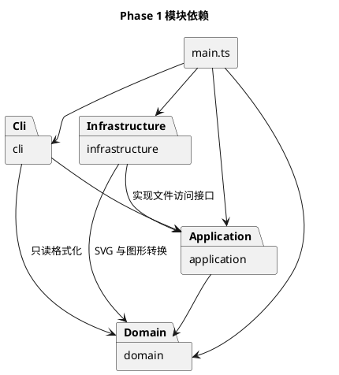

# SVG 编辑器 Phase 1 开发记录

本项目按 [Phase 1 实验要求](Phase1/phase_cli_1.md)实现一个 TypeScript 命令行 SVG 编辑器。目前已完成阶段 5，CLI 支持 init、六种图形的 create、move、scale、set、delete、tree、show、help 和 undo/redo，create 可用 in 指定父容器。分组重排与文件读写按后续阶段实现。下文列出目标架构，实际完成的部分见过程记录。功能范围是 rect、circle、ellipse、line、text 和 g；box 留到后续插件化阶段。

开发分支为 `dev/phase1`。采用测试驱动开发，每个功能先写测试、确认失败，再实现和重构。阶段成果先交人工审核，审核后再提交。阶段 0 至 4 已审核并提交；阶段 5 经独立审查和显示修正后，按人工授权提交。

## 架构方案

### 模块划分

编辑器需要处理三件不同的事：图形如何变化，一次操作如何撤销，以及用户输入和 SVG 文件如何进入程序。把它们分开，是为了测试移动或分组时不必启动终端，也不必读写磁盘。

| 目录 | 职责 | 计划中的主要类或接口 |
| --- | --- | --- |
| `src/domain/` | 图形几何行为、样式、父子关系、唯一 id 和文档尺寸 | Shape、Rect、Circle、Ellipse、Line、Text、Group、SvgDocument |
| `src/application/` | 编辑器会话、编辑命令、历史管理；定义文件访问接口 | EditorSession、EditCommand、ShapeEditCommand、CommandHistory、ShapeFactory、DocumentRepository |
| `src/cli/` | 分词、命令分发、逐行输入和结果显示 | Tokenizer、CommandDispatcher、Repl、TreeFormatter、ShapeFormatter、PositionFormatter、AttributeFormatter |
| `src/infrastructure/` | XML 与领域对象的转换、磁盘文件读写 | SvgParser、SvgSerializer、FileDocumentRepository |
| `src/main.ts` | 创建对象、注入依赖并启动 REPL | 程序入口 |
| `tests/` | 领域、应用、解析和完整会话测试 | 按被测模块组织 |
| `examples/` | 命令回放脚本和示例 SVG | 后续验收时加入 |
| `doc/` | 实验说明与开发记录 | 本文及原始实验要求 |

这是计划目录，阶段 0 不创建空的源码目录。一类一文件，文件名与类名一致；测试文件按被测类命名。图形字段设为 private 或 protected，需要读取时提供只读访问，不能把可修改的子节点数组直接交给调用者。

下面是包依赖图，箭头表示源代码依赖。基础设施对应用层的依赖来自它实现的 DocumentRepository 接口。

### 设计模式的选择

#### Command：把编辑动作和撤销所需的信息放在一起

每种编辑命令实现 EditCommand，提供 execute 和 undo。CommandHistory 只调用这个接口，不判断当前命令是移动、删除还是分组。redo 重新应用已记录的命令，不重新解析用户输入。

命令调用领域对象的方法完成操作。例如 MoveCommand 调用 Shape.move，矩形坐标如何变化由 Rect 决定。命令负责保存恢复信息，不能自己读取图形标签后修改不同类型的字段。

撤销要恢复操作前的状态。删除命令保存子树、原父容器和原位置；分组命令保存各目标的归属和顺序；属性命令区分“原来没设置”与“原来设置了某个值”。移动和缩放也计划保存操作前的几何状态，避免连续浮点运算后再用逆运算恢复造成误差。状态快照由图形类创建和恢复，命令不直接访问私有字段。

一条编辑命令对应一个历史单元。先校验全部参数和结构约束，再开始修改；成功后才更新历史。涉及多个节点的操作要有整体恢复路径，不能在移动了第一个节点之后发现第二个节点非法，就留下半完成的文档。这里只采用命令及其必要的恢复数据，不为每次操作复制整个文档。

init、read、save 和修改尺寸的 canvas 由应用层处理文档生命周期，不进入编辑历史。查询命令也不进入历史。

#### Composite：容器和叶子使用同一个图形接口

Shape 定义 move、scale、set 等行为。Rect、Circle 等叶子类处理自己的几何属性；Group 持有 Shape 子节点，移动或缩放时调用子节点的同名方法，嵌套分组自然递归。

删除由文档的树操作统一处理：找到一个 Shape，移除它及整棵子树。命令不需要为六种类型写六条删除分支。父子关系和 id 索引由文档集中维护，不能由外部直接拼接数组。

Group 的 set 并非把所有属性递归覆盖到叶子。普通 g 只接受公共样式属性，设置在容器自身，保存后遵循 SVG 继承规则。带有显式颜色的子节点仍保留自己的颜色。box 的属性传播属于后续插件语义。

#### 简单工厂：集中创建图形

ShapeFactory 是唯一的“类型名到图形实现”入口。CLI 创建和 SVG 读入都复用它，避免解析器又出现一套按标签分派的逻辑。当前工厂用一张 Map 选择内置类型的创建函数，CreateArguments 处理数量与数值校验，图形构造函数检查几何约束。XML 属性读取留给 infrastructure。暂未为六个创建函数各建一个适配类；后续插件或 XML 读入需要独立适配对象时再拆分。

CommandDispatcher 是唯一的“命令名到命令实现”入口。两个入口均标记为待重构点：阶段 1 内置类型和命令足够，后续再按实际需要改成注册机制，不提前实现插件加载。

#### Visitor：隔离输出格式，避免第三处类型分派

tree、show 和 SVG 输出都要读取不同图形的属性。如果三个输出模块各写一套 switch(tag)，就违反了实验约束。计划用 Shape.accept 和类型对应的访问方法，让格式化器和序列化器通过多态读取图形；树遍历仍按统一的子节点访问接口进行。

这部分比给图形添加 toSvg 方法多了一层接口，但能让 domain 不依赖 XML 库或终端输出格式。新增图形时需要补充访问接口及各输出实现，这个修改成本会在后续插件阶段重新评估。

### 依赖方向规则

- domain 不依赖其他项目模块，也不引用 Node 文件系统、终端或 XML 库。
- application 可以依赖 domain，通过自己的 DocumentRepository 接口访问文件，不导入 infrastructure。
- cli 可以依赖 application 和 domain 的只读接口，不直接读写 SVG 文件。
- infrastructure 可以依赖 domain 和 application 的接口，不依赖 cli。
- main 是装配入口，可以引用各层。业务类中不调用 main。
- tests 可以引用被测模块；测试替身实现同一接口，不反向进入生产代码。

上述约束覆盖所有子目录。发现反向依赖时先记录具体文件和原因，再决定移走职责或修订方案，不能只改图让违规依赖消失。

### 变化点假设

| 可能变化的地方 | 本次准备保留什么 | 暂时不做什么 |
| --- | --- | --- |
| 输入从 CLI 扩展到 GUI 或 agent | 编辑命令与图形行为独立于终端，入口可复用应用层 | GUI、网络接口 |
| 新增图形和 box 插件 | 图形创建集中到工厂，操作依赖 Shape；记录工厂和 Visitor 的扩展成本 | 动态加载、插件协议及 box 实现 |
| SVG 支持范围扩大 | XML 转换集中在 infrastructure；支持范围写成测试 | 完整 SVG 标准实现 |
| 换成其他存储位置 | DocumentRepository 接口和测试替身 | 云端存储、自动保存 |
| 撤销策略调整 | 历史管理独立；恢复数据由命令和领域对象管理 | 历史持久化、无限历史、并发编辑 |

## 命令语义与待审核决策

实验文档写明的规则直接作为验收依据。以下补充解释是本次方案的选择，不是助教额外给出的要求；尚未确定的地方列在本节末尾。

### 已明确的操作规则

- 坐标原点在左上角，支持有限浮点数。scale 因子必须大于零，按实验要求同时缩放位置与尺寸；不改成围绕中心缩放，也不乘到 stroke-width。
- front 将目标放到直接父容器的子列表末尾，视觉上置顶；back 放到开头，视觉上置底。只改变同级绘制顺序，容器内部顺序不变。
- create 的 in 子句在创建时确定归属；addto 将已有节点移到目标容器末尾。禁止将自己移入自己或子孙节点。
- ungroup 将子节点提升到原组所在的位置，保留子节点顺序。按照实验的特殊约定，svg 的直接子容器不能解散。
- create 的必需参数完整后，多出的尾随 in 视为缺少容器名，报 missing container id after in。可选颜色位置上的 in 即使用引号包裹也拒绝；text 的必需文字内容 "in" 仍合法，容器 id 也可为 in。这是为减少漏写容器名造成的静默创建而作出的补充规则。
- 缺省 fill 和 stroke 不写入 SVG。撤销 set 时，如果原先没有该属性，要删除本次添加的属性，而不是写入渲染默认值。
- 只把去掉行首空白后以 # 开始的整行视为注释。参数中的 #4a90d9 是颜色；引号内的 # 是文字。不引入行尾注释语法。
- read 自动补 id 时先收集全部显式 id，再按文档顺序分配标签名加序号，跳过已占用名称。显式 id 重复则读入失败。
- 未建立文档时，help 仍可使用；其他需要文档的操作按实验输出 no document 错误。这是对“其他命令”表述的可用性补充。

### 历史屏障

成功执行 init、read、save 或带尺寸的 canvas 后，计划清空编辑历史并开启屏障；undo、redo 均输出实验约定的禁止信息。下一次成功编辑关闭屏障，该编辑成为新的第一个撤销单元，不能撤销越过前一次文档操作。

canvas 不带参数只查询，不清空历史。失败的编辑不清空 redo，也不关闭屏障；失败的文件操作不改当前文档、路径和历史。

清空旧历史是本项目的实现选择。文档明确要求屏障存在，但没有规定旧历史是否保留。用测试固定这个选择，避免“重新解禁”后恢复到读入前的另一份文档。

### group 的补充规则

文档允许从不同父容器收编图形，却没有说明新组的父级和跨容器顺序。计划采用以下规则：

1. 先验证新 id、全部目标和祖先关系；目标重复，或同时选择一个容器及其子孙时拒绝操作。
2. 新组放在全部目标的最低公共祖先容器中。只有一个目标时采用它的直接父容器。
3. 分组前按文档树的遍历顺序确定新组内部顺序，与命令参数排列无关；同父级目标因此保持原有相对顺序。
4. 新组放在该公共祖先中最早包含目标的直接子节点位置。原父容器即使变空也保留。
5. undo 恢复各目标原来的父级和索引，同时移除新组。

同父级例子：原列表 [a, b, c, d]，执行 group g c a，结果为 [g(a, c), b, d]。

跨父级例子：root 下有 p(a, b) 和 q(c, d)，执行 group g d a，结果为 [g(a, d), p(b), q(c)]。这里会改变原先跨组的覆盖关系，文档没有要求这种操作保持所有视觉关系不变。实现前需要人工审核这个选择。

### SVG 读入范围尚未定案

必须完成的基线是六种内置元素、嵌套 g、实验列出的属性、文字内容、id 补全，以及本编辑器输出文件的读回。XML 特殊字符需要正确转义和还原。

原文背景示例还包含 transform、font-size 和 text-anchor，而命令白名单并未包含它们。非默认 viewBox 也会改变坐标与显示的对应关系。阶段 7 前需要确定这些输入的处理方式：

| 输入 | 待定问题 |
| --- | --- |
| translate / scale 及嵌套 transform | 保存变换还是展开几何坐标；编辑后如何保持原外观 |
| 与画布不一致的 viewBox | 保留内部坐标系还是统一转换；canvas 修改尺寸的含义 |
| font-size、text-anchor 等额外属性 | 原样保留哪些属性，哪些允许编辑 |
| 六种类型之外的元素 | 明确拒绝还是支持某些非图形元数据；不能静默删除 |
| 带 data-kind="box" 的 g | 按原文降级为普通 Group；是否原样保留标记 |

在范围确定之前，不宣称支持任意外部 SVG。最少要保证不支持的影响外观的内容得到明确反馈，read 失败时原文档不变。

另外，save 无参数在 read 后使用读入路径。init 后还没有路径时如何报错，以及显式 save 成功后是否更新默认路径，原文未说明；计划采用“最近一次成功 read/save 的路径”，错误文案在 CLI 阶段补入测试。

## 分阶段实施

每一阶段都先交审核，不自动 commit、push 或打 tag。以下 commit 标题只是建议，实际提交时按最终改动重写。

| 阶段 | 工作内容 | 优先写的测试 / 验收依据 | 建议提交标题 |
| --- | --- | --- | --- |
| 0 | 架构、语义、开发计划 | 对照要求检查文档，不把方案当实现 | docs: define phase 1 architecture and command semantics |
| 1 | TypeScript 工程、构建、测试入口、最小 CLI | 测试工具能运行，CLI 能启动并结束 | chore: scaffold TypeScript CLI and test tooling |
| 2 | 六种图形、分组和文档模型 | 几何操作、样式验证、唯一 id、父子关系与循环拒绝 | feat(domain): implement shapes and composite document model |
| 3 | 编辑命令和历史管理，先覆盖创建、移动、删除 | 执行/撤销/重做，删除恢复位置，新编辑与失败编辑对 redo 的影响 | feat(application): add reversible commands and history |
| 4 | REPL、分词、基本编辑及查询、in、undo/redo | 双引号、中文、颜色、注释、错误输出、嵌套创建 | feat(cli): expose document and basic editing commands |
| 5 | scale、set | 全部类型白名单，位置与尺寸缩放，属性缺省状态恢复 | feat(commands): add scaling and attribute editing |
| 6 | group、ungroup、addto、front、back | 跨父容器操作、顺序恢复、循环拒绝、单次撤销恢复整个分组 | feat(commands): add grouping and sibling ordering |
| 7 | SVG 转换、read/save/canvas、路径和屏障 | XML 往返、id 补全冲突、失败原子性、文件操作后的历史规则 | feat(svg): add document import and export |
| 8 | 完整会话验收与缺陷修正 | 回放原文第 6 节和 6.1 节版本 A，浏览器检查输出 SVG | test: verify phase 1 command sessions and edge cases |
| 9 | 更新文档、依赖检查和交付 | 新环境运行，实际目录与方案核对；审核后完成提交、推送及 final tag | docs: finalize architecture review and usage guide |

阶段较大时可以按自然功能边界拆成两次提交。例如阶段 2 分为叶子图形与文档树，阶段 7 分为输出与读入。测试随功能一起进入提交，不到最后才补。发现真实缺陷时单独提交修复，记录复现条件。

阶段 4 结束时应已有可操作的 CLI；后面的阶段在它上面逐步加入功能。box 不在本次验收范围内，不能把 6.1 节版本 B 当成阶段 1 的未完成项。

## 过程记录

### 2026-10-11：确定实现方式

前期讨论过 SVG-Edit 等开源项目，随后决定从零实现。原因是本实验同时要求 TypeScript、字段封装、图形类多态和 Command，功能相似的编辑器未必采用相同的对象模型。

需求讨论中发现 front/back 的“同级最前/最后”容易混淆列表顺序和视觉层次，因此在本方案中明确末尾对应置顶。还区分了普通 g 与后续 box：两者都能使用组合模式，但 box 的内部部件由插件管理，禁止 ungroup 的复合图形规则不能套到全部普通分组上。

最初计划按功能分阶段实现，之后根据人工提出的建议改为 TDD。每个功能需要留下 Red、Green 和重构的实际检查记录；不把尚未执行的测试写成通过。默认提交测试和实现都通过的功能，Red 阶段记录在开发过程里。

本次只检查了仓库、实验要求和分支，编写方案。当前分支是 dev/phase1，开始前工作区没有未提交改动，仓库没有源码或测试配置。方案由 Codex 协助整理，后续按人工审核意见修订；不伪造已经发生的开发经历。

### 2026-10-11：阶段 1 工程骨架

阶段 0 文档经人工审核后，按明确授权提交为 `011f26a`（docs: define phase 1 architecture and TDD plan）。随后开始工程骨架。阶段 1 经人工审核后提交为 `26f3762`（chore: scaffold TypeScript CLI and test tooling）；按审核意见删除了根目录 README，留到最终交付再写。

本机 Node.js 为 22.20.0，npm 为 10.9.3。开发依赖固定为 TypeScript 5.9.3 和 @types/node 22.19.15，使用本机 npm 缓存离线安装，并生成 package-lock.json。测试使用 Node 自带的 node:test 和 assert，没有额外安装测试框架。编译采用 NodeNext 模块解析和严格类型检查；有编译错误时不输出新文件。配置依据是 [TypeScript 模块说明](https://www.typescriptlang.org/tsconfig/module.html)、[noEmitOnError 说明](https://www.typescriptlang.org/tsconfig/noEmitOnError.html)和 [Node 测试运行器说明](https://nodejs.org/download/release/v22.23.3/docs/api/test.html)。

先写了 4 个 Repl 行为测试和 1 个入口进程测试。为使它们能编译，Repl 起初只保留构造参数和空的 run 方法，入口负责创建并调用它。

| 检查 | 实际结果 |
| --- | --- |
| Red：首次 npm test | 编译成功，5 个测试失败；断言期待欢迎语、提示符和逐行反馈，实际输出为空 |
| Green：实现 Repl 后 npm test | 5 个测试全部通过 |
| npm run typecheck | 通过 |
| 空行和注释经管道传入 npm run cli | 构建成功，显示欢迎语和提示符，读到 EOF 后正常退出 |
| Git 忽略检查 | node_modules 和 dist 不进入版本管理 |

Repl 通过构造参数接收输入输出流，单元测试使用内存流，不改写全局 stdin/stdout。它目前只处理逐行读取、空行、整行注释以及 EOF；其他输入明确输出 `error: command handling is not available yet`，随后继续读取。这个临时反馈会在阶段 4 接入命令分发时替换，不能作为实际编辑命令的验收结果。

Green 后检查了入口与 Repl 的职责，入口只装配对象；读取接口在 finally 中关闭。暂时没有需要抽出的公共逻辑，也没有加入工厂、命令或空的领域层目录。命令分词和图形模型按原计划留到后续阶段。

### 2026-10-11：阶段 2 图形与文档模型

本阶段新增 domain，CLI 的输入处理保持原样。先完成叶子图形，再完成分组与文档树，分别运行了一轮 Red 和 Green。

| 检查 | 实际结果 |
| --- | --- |
| 叶子图形 Red | 编译成功；新增 39 个测试失败，原有 5 个 CLI 测试通过 |
| 叶子图形 Green | 44 个测试通过 |
| 分组与文档树 Red | 编译成功；新增 24 个测试失败，已有 44 个通过 |
| 分组与文档树 Green | 68 个测试通过 |
| npm run typecheck | 通过 |
| 依赖和类型分派检查 | domain 只导入同目录模块，没有 Node、CLI 或 XML 依赖，没有 switch(tag) |

测试先于行为实现加入。为让测试编译，起初只提供构造参数、只读查询和抛出“尚未实现”错误的方法骨架；没有把缺文件或编译失败记作 Red。首轮测试验证了移动、缩放、属性验证、溢出失败与状态恢复；第二轮验证了嵌套组合、树结构和 Visitor 调用。

Rect、Circle、Ellipse、Line、Text 分别保存自己的私有几何状态，自己的移动与缩放方法计算新值。Shape 处理公共样式、参数验证及失败恢复。AttributeValidator 集中处理有限数值、非负尺寸、十进制字符串与属性名检查，减少各类重复的校验逻辑。属性检查按本类已有的几何字段进行，不根据图形标签分派。

几何值、样式和 children 都返回只读副本，并在运行时冻结。这样既能供测试和后续输出读取，也不能通过修改返回数组绕过文档规则。六种类型的 accept 已接到 ShapeVisitor；本阶段只验证访问方法调用，tree/show/SVG 输出仍未实现。

实现分组时有一个容易漏掉的失败路径：第一个子图形已经移动，后面的子图形计算出 Infinity。只校验 dx/dy 并不能避免这种情况。因此加入 ShapeState，保存几何、文字和样式；Group 保存其子孙的状态，变换失败时恢复全部已修改节点。测试特意把会溢出的图形放在后面，确认前面的矩形回到原值。恢复不使用反向乘除，快照也可以重复恢复。它不保存父级、顺序或画布尺寸，结构撤销将在命令阶段另外记录。

SvgDocument 使用 id 索引和父级映射管理树。公开结构操作为 add、remove 和 reparent；插入前检查整个子树，确保没有重复 id 或已经归属其他文档的节点。remove 释放全部子孙的索引和归属，但保留被移除的子树对象，供后续删除撤销使用。同一节点不能同时挂在两份文档中。

Group 本身不提供公开的 add/remove 方法。TreeAccess 的符号入口只用于领取独占的 GroupTreeAccess 写入句柄。SvgDocument 在加入子树时领取并私有保存全部句柄；已归属文档的 Group 拒绝再次领取，导入符号也不能直接改写子列表。移除子树时释放句柄，旧句柄随即失效。外层命令仍通过 SvgDocument 修改结构。根级图形的 parentOf 结果为 null，嵌套图形则返回实际 Group。reparent 的显式索引指移除目标后的目标列表位置。

本阶段补充了几项输入校验：几何尺寸、半径和 stroke-width 允许零，拒绝负数；坐标允许负数；画布尺寸必须为正；id 不能为空或含空白。数字字符串接受十进制、小数和科学计数法，拒绝空串及十六进制。这些是项目的补充决策，不是原文给定的固定错误文案。

新增辅助文件为 AttributeValidator、ShapeState、TreeValidator、ShapeVisitor、TreeAccess 和 GroupTreeAccess，均在 domain 内，没有调整模块依赖方向。Command、历史管理、工厂及文件读写尚未实现。本阶段未创建根目录 README，也未执行提交、推送或 tag。

### 2026-10-11：阶段 2 审查修正

独立审查发现，原先导出的 replaceChildren 符号可以直接替换 Group 的子列表，却不更新文档索引。按人工决定处理 A 和 D，样式白名单与递归快照的整理暂留后续阶段。

先补了 6 个测试：3 个检查结构写入权限，3 个检查同父重排、子树迁移和只读副本；已有测试也补上移动节点及兄弟节点的 indexOf 断言。Red 时共 74 个测试，71 个通过、3 个权限测试失败。直接传入空子列表的复现暴露了原入口没有拒绝外部写入的问题。

修复后，文档领取子树中全部 Group 的独占句柄，再修改树和索引。领取中途失败会释放已领取的句柄，文档不留下部分新增节点；删除子树会释放所有句柄，允许之后重新加入另一份文档。Group 的子列表、领取标记和文档的句柄表使用 JavaScript 私有字段，旧句柄在释放后不能写入，也不能释放新持有者的权限。

只读性测试保留冻结检查，另行检查修改可编辑副本不影响内部列表，以及文档修改后先前取得的副本仍保留原内容。叶子图形测试的几何字面量也统一了格式。

| 检查 | 实际结果 |
| --- | --- |
| 修复后 npm test | 74 个测试全部通过 |
| npm run typecheck | 通过 |

### 2026-10-11：阶段 3 编辑命令和历史

阶段 2 经审核后提交为 bf1cbb5。本阶段新增 application，先写创建、移动、删除、历史与会话的 32 个测试，给方法提供可编译的骨架，然后运行 Red。原有 74 个测试通过，新增 32 个均因行为尚未实现而失败。完成实现后运行 Green，共 106 个测试通过；类型检查也通过。

EditCommand 是抽象基类，统一检查执行状态和文档归属。每个命令实现自己的执行与撤销方法；成功执行后才能撤销，撤销后才能再次执行。命令只绑定首次成功执行的文档，防止重新 init 后拿旧命令修改新文档。一个命令对象只代表一次编辑，重做由历史管理调用，不能把同一对象再次当作新编辑入栈。

CreateCommand 接收已经构造好的 Shape，加入指定父容器，记录实际插入位置与创建时的状态。撤销移除同一个对象，重做恢复到原位置。图形类型参数的解释留给下一阶段工厂，本阶段没有增加按类型名的分派。

MoveCommand 调用 Shape.move，保存操作前后的 ShapeState。undo 恢复原快照，redo 恢复成功执行后的快照，不反复加减位移。测试使用 0.1、0.2 这类浮点值连续撤销、重做十轮，并逐次比较精确结果。对嵌套 Group 使用同一条命令，整组只占一个历史单元。

DeleteCommand 保存被删除的对象、原父容器、原索引及属性快照。撤销先经文档校验并插回整棵子树，再恢复几何、文字与样式。测试检查原位置、子孙 id、父级和索引，也检查调用者修改已摘下对象后仍能恢复保存的属性。结构变更仍只经 SvgDocument，命令不导入 TreeAccess。

CommandHistory 使用 undo、redo 两个栈，只有命令完成后才移动栈项。新编辑成功时清空 redo；编辑失败、撤销失败或重做失败都保留原历史。为了确认这不是只在正常路径成立，测试在删除后插入冲突 id，让 undo 失败，移除冲突后再次 undo；redo 也做了对应检查。混合创建、移动、删除的测试验证了整段历史的顺序与最终状态。

EditorSession 管理当前文档和对应历史。initialize 先构造并验证新文档，成功后才替换会话；尺寸非法时原文档和 redo 都保留。initialize 会建立历史屏障；下一条成功编辑解禁，失败编辑不解禁。屏障会清空旧历史，两种历史操作均使用原文约定的 undo not allowed after io command；非屏障下空栈的错误采用 nothing to undo / nothing to redo。查询文档不进入历史。

| 检查 | 实际结果 |
| --- | --- |
| Red：npm test | 编译成功，74 个通过、32 个失败 |
| Green：npm test | 106 个测试全部通过 |
| npm run typecheck | 通过 |
| 依赖与分派检查 | application 只导入自身及 domain；domain 未增加外层依赖；没有按图形标签分派 |

本阶段尚未接入 CLI，read/save/canvas 和文件访问接口也未实现。会话已提供建立屏障的入口，后续文件操作只能在成功后调用。初版没有修改领域层，也未创建根目录 README；当时先交人工审核，没有执行提交、推送或 tag。

### 2026-10-11：阶段 3 审查修正

独立审查没有发现阻断性问题。按人工决定采纳意见 3、4、5：冻结 ShapeState，分别核对不存在的父级与非容器父级的完整错误文案，并在历史层补上浮点移动和嵌套 Group 重做的正式测试。双历史对象和历史外结构修改的建议未在这次改动中实施。

先新增 3 个测试并收紧已有断言。运行结果为 108 个通过、1 个失败；失败项报告缺少预期的 TypeError，说明恢复方法可以被覆盖。ShapeState 构造时加入 Object.freeze 后，共 109 个测试通过，npm run typecheck 通过。冻结限制的是快照实例本身，不宣称它能阻止绕过 TypeScript 封装替换命令的私有字段。

新增历史测试都通过 CommandHistory 执行十轮 undo/redo，逐轮检查精确坐标和历史栈数量。嵌套 Group 测试同时检查子节点与父级关系，确认重做不会把内层图形移动两次。

阶段 3 按人工授权提交，包含应用层初版及这次审查修正。本轮没有推送或创建 tag。

### 2026-10-11：阶段 4 CLI 接入

阶段 3 经审查修正后提交为 6e8ca5a。本阶段先写分词、图形工厂、格式化及命令分发的 24 个测试，再给新类提供可编译的方法骨架。首次 Red 是原有 109 个通过、新增 24 个失败；实现后 133 个全部通过。

随后更新原有 REPL 的临时反馈测试，新增 2 个 REPL 会话测试和 1 个入口进程测试。接入前共 136 个测试，其中 132 个通过、4 个失败；失败项为这 3 个新增测试及已更新的旧测试。Repl 接到 CommandDispatcher 后，136 个全部通过，npm run typecheck 通过。这两轮是实际运行结果，没有将编译失败当作 Red。

Tokenizer 保留空文字、中文、参数中的 # 和双引号内的空格。只在去掉行首空白后以 # 开始时跳过整行，不解释行尾注释。引号必须包住完整参数，引号内支持转义双引号与反斜线；其他转义、未闭合引号和引号前后拼接文字都明确报错。

工厂与命令分发各使用一张 Map，未注册的名字不会落到 Object 原型属性上。工厂只负责六种内置图形的创建，省略颜色时不补默认值。类型参数当前放在工厂内的创建函数中，公共解析交给 CreateArguments；这是对最初“每种类型一个创建适配对象”方案的简化。两处名字查找仍是后续插件化的待重构点。

CommandDispatcher 解释参数并创建应用层命令，编辑仍通过 EditorSession 进入历史。create 的尾部 in 子句只指定父容器；缺少父级和叶子父级的错误由 SvgDocument 处理。init 可省略尺寸，也可只给宽度，此时高度为 600；与原文两个可选参数的写法一致。help 当前列出已接入的九条命令及六种 create 参数，后续命令接入时补入。

ShapeFormatter 与 PositionFormatter 实现 ShapeVisitor：前者供 tree/show 输出几何、文字和显式样式，后者供移动反馈读取当前位置。TreeFormatter 只按 children 递归，不判断标签。文字使用带转义的引号显示；省略的样式不出现在输出中。当前没有为齐列添加按最长 id 计算的空格，树分支、属性和父级信息已固定在测试中。

撤销反馈保存在 CLI 的 WeakMap 中，命令和历史本身不依赖终端文案。undo/redo 返回哪个命令，就调用它对应的反馈函数读取恢复后的坐标；Group 则反馈位移。查询、空行和注释不影响历史，新编辑成功才清空 redo。Repl 在每行捕获参数和领域错误，统一输出一行 error:，随后继续提示；EOF 正常结束。

| 检查 | 实际结果 |
| --- | --- |
| 分词、工厂、格式化与分发 Red / Green | 109 通过、24 失败 / 133 全部通过 |
| REPL 接入 Red / Green | 132 通过、4 失败 / 136 全部通过 |
| npm run typecheck | 通过 |
| npm run cli 流程图回放 | 两节点嵌套创建、整组移动、查询、撤销、重做、删除与恢复正常；EOF 退出 |
| 依赖检查 | application 新文件仅依赖自身和 domain；CLI 不读写文件；没有新增按图形标签的条件分派 |

回放使用了实验 6.1 版本 A 的容器与连线结构，文字改为英文，省去本阶段尚未接入的 set/save。中文内容已由 REPL 测试覆盖。这个回放不算完整实验验收，也没有 SVG 文件可供浏览器预览。

本阶段未修改领域层和已有应用命令，也未创建根目录 README。scale/set、group/ungroup/addto/front/back、read/save/canvas 仍未接入。初版先交人工审核，当时没有执行提交、推送或 tag。

当前可在根目录运行 npm run cli，通过 EOF 结束会话。最小操作如下：

~~~text
init 400 200
create g flow
create rect start 30 70 120 60 #4a90d9 in flow
create text label 45 105 "开始" in flow
tree
move flow 10 0
undo
redo
show start
~~~

### 2026-10-11：阶段 4 审查修正

独立审查没有发现阻断性问题，但发现 create rect r 0 0 1 1 in 会把漏写容器名的 in 当成颜色，静默创建图形。按人工决定修正这条正常输入路径，补齐创建撤销/重做的反馈测试，并为分发器中优先检查文档的语句加上注释。空命令名的文案保持原样。

先新增 3 个测试，结果为 138 个通过、1 个失败；失败项复现了尾随 in 未报错的问题。CreateArguments 复用各类型已有的必需参数数量：最后一项为 in 且去掉后仍有足够必需参数，就报缺少容器名。没有在命令分发器新增按图形类型的条件判断，也没有更改 Tokenizer 的返回类型。

补充测试覆盖四种可选颜色类型、text 和 g 的缺参写法，也检查带引号的颜色 in 被拒绝。必需文字 "in" 与容器 id 为 in 的合法组合仍然通过；失败命令不增加节点且保留 redo。创建反馈测试分别检查根级和嵌套创建的撤销、重做，验证同一对象、归属和索引。

修复后 npm test 为 139 个全部通过，npm run typecheck 通过。阶段 4 的初版和审查修正按人工授权一起提交，没有推送或创建 tag。

### 2026-10-11：阶段 5 缩放与属性修改

阶段 4 经审查修正后提交为 852d011。本阶段先新增 ScaleCommand、SetCommand 和 CLI 行为的 20 个测试。最初测试数组的几何字段索引有静态类型错误，改为通过 Shape 接口读取后编译成功；这次编译错误没有计作 Red。随后 npm test 为原有 139 个通过、新增 20 个失败。实现后共 159 个全部通过，npm run typecheck 通过。

本轮曾临时保存运行输出摘录；提交前按人工决定删除，本文保留实际 Red/Green 结果，没有补造此前阶段的失败输出。

移动、缩放和 set 都需要保存同一个图形的操作前后状态，因此把 MoveCommand 原有的快照与目标校验抽成 ShapeEditCommand。三个具体命令只分别调用 Shape.move、scale、set。首次修改成功后保存两份快照，undo 恢复前值，redo 恢复后值；修改失败时恢复操作前状态，不让失败命令进入历史。已有移动测试仍全部通过。

ScaleCommand 对位置和尺寸同时乘因子，Group 递归作用于子孙，stroke-width 与文字内容保持原值。测试覆盖五种叶子的全部几何字段和嵌套组，通过历史连续十轮撤销、重做，并把会溢出的子节点放在后面，检查先前节点也恢复原值。一次组缩放只占一个历史单元。

SetCommand 不复制属性白名单，仍由图形类验证自身属性。测试逐一设置五种叶子的几何字段，并覆盖六种类型的 fill、stroke、stroke-width。Group 只设置自身样式，不覆盖子节点显式颜色，也不把继承颜色写入子节点。几何、文字和样式都通过同一份快照恢复；原来省略的样式在撤销后重新缺省，不写入默认黑色。

CLI 接入两条命令并补入 help。AttributeFormatter 通过 Visitor 读取文字内容，通过公开只读查询读取几何与样式，不按图形标签判断。set 的成功、撤销与重做都显示当时实际值：数值显示规范化结果，字符串带引号，缺省属性显示 (unset)。例如 set r stroke-width 2e0 反馈 stroke-width=2；新设 fill 的撤销反馈 fill=(unset)；文字为空则显示 text=""，两种情况不会混淆。

scale 的成功与重做反馈 scaled by <factor>，撤销反馈 scale restored；实际几何可经 show/tree 核对。失败缩放和属性设置保留 redo；缺少文档时优先报 no document，参数数量错误与白名单错误明确反馈。真实入口测试覆盖中文、空文字、无效因子、非法属性，以及报错后继续撤销和查询。

| 检查 | 实际结果 |
| --- | --- |
| Red：npm test | 编译成功，139 个通过、20 个失败 |
| Green：npm test | 159 个全部通过 |
| npm run typecheck | 通过 |
| npm run cli 回放 | 整组缩放、样式设置、文字修改、撤销/重做与失败后恢复正常 |
| 依赖与分派检查 | 新应用类仅依赖自身和 domain；属性反馈通过 Visitor；没有新增类型名分派 |

本阶段未修改 domain，也未接入分组重排和文件读写。Group 的递归快照仍可能在多个层级重复保存子孙状态，本次只收拢命令层的重复代码，没有做性能优化。初版先交人工审核，当时未执行提交、推送或 tag；根目录 README 仍留到最终阶段。

### 2026-10-11：阶段 5 审查修正

独立审查没有发现阻断性问题，但指出空字符串样式在 show/tree 中显示为 fill=，不够清楚。按人工决定修正 ShapeFormatter，让空串显示为 fill="" 或 stroke=""；真正缺省的样式仍不输出。

先补一个 CLI 回归测试，覆盖 fill 和 stroke 的设置、show/tree、撤销到空串、继续撤销到缺省以及重做。Red 为 159 个通过、1 个失败；修复后 160 个全部通过，npm run typecheck 通过。审查报告举例中“空串改成 x 后撤销得到 unset”的说法不准确，测试固定的是先恢复空串，再撤销才恢复缺省。

共用命令层的失败恢复保持原样。按人工决定删除临时 test-logs 及文档链接，代码、测试和开发记录随阶段 5 一起提交，没有推送或创建 tag。

### 后续记录方式

每条记录说明当时发现了什么、如何复现或确认、最终改了什么，并附实际执行的检查及结果。修改依赖方向、分组规则或 SVG 支持范围时，在这里说明理由，同时更新对应方案。暂未执行的检查保留为待验收。

## 一致性自查

阶段 5 已接入 scale/set。分组重排和文件访问仍待实现，下表记录当前检查范围。

| 检查项 | 当前结果 | 实现后如何核对 |
| --- | --- | --- |
| 模块目录与职责 | src/main.ts、src/cli/、src/domain/、src/application/ 及对应 tests 目录符合方案；文件访问与示例待实现 | 列出实际目录；不一致处附修订记录 |
| 依赖方向 | domain 仅依赖域内模块；application 只依赖自身和 domain；Repl 依赖 Node 流与逐行读取；未发现跨层反向依赖 | 检查 import，尤其是 domain 的外部依赖与 application 到 infrastructure 的反向引用 |
| 类封装与一类一文件 | 图形状态、文档索引、命令恢复信息、历史栈及会话字段封装；只读查询冻结副本；类文件名一致 | 检查公开可修改字段、子节点数组和文件命名 |
| 类型分派位置 | 按名字查找集中在 CommandDispatcher 和 ShapeFactory；格式化走 Visitor；两处入口已标记为待重构 | 检查 switch、类型字符串条件链及注册查找，确认集中在两个指定入口 |
| Command 与 Composite | 创建、移动、缩放、set、删除经 CLI 接入命令与历史；嵌套 Group 操作及撤销/重做已验证 | 检查命令的恢复数据及调用关系，验证叶子和分组使用统一操作 |
| 功能与错误约定 | 待验收 | 对照命令表、错误表和会话回放结果 |

## 质量保证手段

### TDD 的执行方式

先写一个描述公开行为的测试，再运行它。Red 的原因必须是目标行为还没实现；如果失败来自导入路径或测试环境，要先修好环境，不能把这种失败算作行为验证。Green 之后整理职责、命名和重复代码，再跑相关测试。

测试读取公开结果，不访问私有字段，不要求内部必须使用某种数组方法。比如 front 的测试检查同级顺序及其他容器未变；撤销删除的测试检查 id、父级、顺序和全部子孙恢复。快照可以作为辅助，但不只用大段快照代替具体断言。

### 重点验证的问题

- 六种图形分别验证移动和缩放。数值计算使用合理误差比较；撤销应恢复保存的原值。
- 对重复 id、不存在的目标、非法参数和循环包含，比较失败前后的文档与历史；尤其检查失败编辑没有清空 redo。
- 使用嵌套 g 验证组合语义，再检查 group/ungroup/addto 的父级和索引恢复。
- 设置容器样式后验证子节点显式属性保留；撤销新增属性后验证它重新缺省。
- CLI 输入覆盖空文字、带空格文字、中文、颜色中的 #、整行注释、浮点数和错误参数数量。引号转义规则在分词阶段先写进测试。
- read 使用已有 rect1 加一个无 id 的 rect，确认不会分配冲突 id。解析失败和文件失败都不能换掉当前文档或建立历史屏障。
- 通过应用层的文件访问替身验证历史与失败行为，再用临时文件验证实际读写。
- 最后回放实验会话，保存 SVG 后在浏览器检查外观；读回后比较结构和属性。序列化与解析可能共享同一错误，因此还要分别对照独立 SVG 样例。

阶段检查包括相关测试、类型检查和构建。更改跨模块职责时运行全部测试。阶段 0 检查了文档链接、内容覆盖和 Git 差异。阶段 1 已建立测试入口，实际结果见过程记录；当前通过 `npm run cli` 启动，`npm test` 运行测试，`npm run typecheck` 检查类型。根目录 README 留到最终交付时再写。XML 库在读写阶段确定后补入说明。

测试通过不能证明架构符合要求。提交前还需人工检查依赖方向、封装、两处名字分派，以及命令中是否混入了按图形类型修改数据的逻辑。

### 最终交付检查

完成实现后补充实际运行命令和结果、示例路径及已知限制。最终提交与 final tag 应在截止时间前完成并推送到远程；当前尚未确定截止时间。阶段 0 至 4 已提交，阶段 5 按人工授权提交；尚未执行推送或创建 tag。
