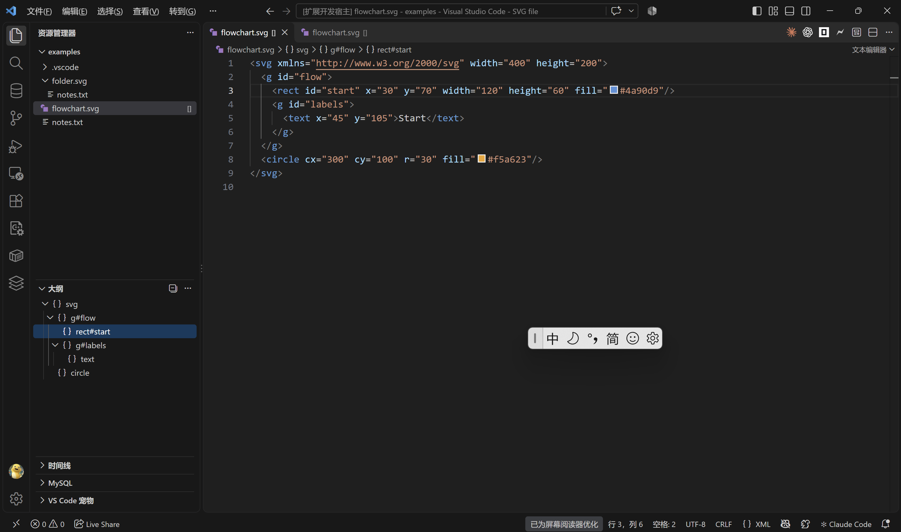

# SVG App Tools

一个帮助阅读 SVG 源码的 VSCode 扩展：在文件资源管理器中标记 SVG 文件，在大纲中展示元素层级，并支持点击节点跳转到源码。

## 功能

- 为 `.svg` 和 `.SVG` 文件添加 `[]` 标记，不改变文件名或文件内容。
- 在 VSCode 原生大纲（Outline）中展示根元素、分组和子元素，保留源码顺序。
- 有 id 的元素显示为 `标签名#id`，没有 id 的元素显示标签名。
- 点击大纲节点跳转到对应标签，编辑内容后大纲自动更新，无需先保存文件。

## 环境要求

- VSCode 1.95 或更高版本。
- Node.js 22 和 npm。

## 快速开始

克隆本仓库后，在仓库根目录运行：

```powershell
npm --prefix vscode-extension ci
npm --prefix vscode-extension run build
code .
```

1. 在 VSCode 左侧打开“运行和调试”。
2. 选择 `Run SVG App Tools`，按 F5。
3. 在新打开的扩展开发窗口中，打开示例文件 `flowchart.svg`。
4. 展开“大纲 / Outline”，点击节点查看对应源码。

也可以单独用 VSCode 打开 `vscode-extension` 目录，选择同名配置启动。示例文件见 [flowchart.svg](examples/flowchart.svg)。

## 运行效果

SVG 文件右侧显示 `[]`，普通文本文件和目录没有标记。大纲按层级排列元素，点击 `rect#start` 可以跳转到矩形标签。



## 使用说明

- 大纲读取编辑器中的当前文本。修改 id 后，节点名称随之更新。
- 文件标记只用于普通 SVG 文件，名称以 `.svg` 结尾的目录不会被标记。
- 编辑过程中 XML 暂时不完整时，大纲可能清空；修复标签后会重新显示，文本编辑不受影响。
- 大纲可以展示 path 等 SVG 元素。几何属性和完整 SVG 规范的校验需使用其他工具。

## 常见问题

### 打开 SVG 后显示图片，没有大纲

在编辑器标签上右键，选择“重新打开编辑器的方式 / Reopen Editor With…”，切换到文本编辑器。可以将文本编辑器设为该类文件的默认打开方式。

示例工作区已配置为默认打开源码。如果仍显示图片，关闭已有预览标签后重新打开文件。

### F5 启动时报缺少 engines.vscode

关闭报错窗口，回到原窗口，在“运行和调试”中选择 `Run SVG App Tools` 后重新启动。

## 相关文档

- [项目主页](../README.md)：命令行 SVG 编辑器的安装与用法。
- [扩展验证记录](docs/VSCode扩展验证记录.md)：运行截图和验证结果。
